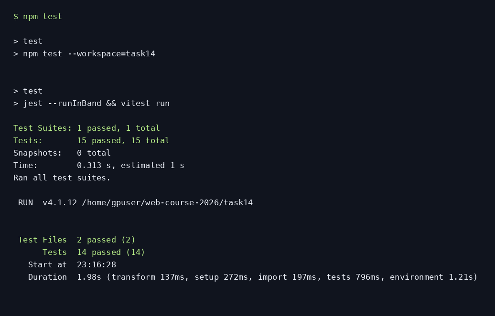

# Тестирование: Jest и React Testing Library

Из корня: `npm ci`, затем `npm test` (или `npm test --workspace=task14`). Jest проверяет функции task4, Vitest + React Testing Library — компоненты task10 и логику task11.

Покрыты все ветви подсчёта быков/коров, отклонение некорректных входов, генерация, добавление кнопкой/Enter, пустой ввод, toggle/delete, фильтры и сортировка без мутации. Это примерно 80% основных пользовательских сценариев выбранных приложений; точный процент строк не измерялся. CSS, внешние API, Canvas и таймеры проверяются отдельно браузерными сценариями, а не этими unit-тестами.

Результат: **29 тестов проходят** (15 Jest + 14 Vitest/RTL).

[Полный вывод](tests-output.txt) · [Изображение вывода терминала](tests-result.png)

